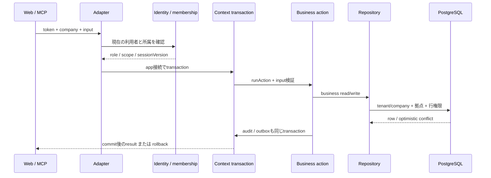
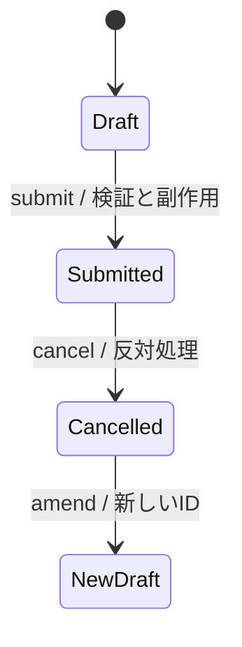

# データと処理経路

[全体像](README.md) / [権限](permissions.md)

## 1リクエストの流れ

RESTは [request-context](../../apps/api/src/request-context.ts) と [routes](../../apps/api/src/routes/) を、MCPは [tools](../../apps/mcp/src/tools.ts) と [session](../../apps/mcp/src/session.ts) を使います。入力をZodで検証しても認可の代わりにはなりません。[runAction](../../kernel/src/actions/run.ts) とRepositoryが認可・行条件を適用します。

## 業務データの形

Entityは `id/tenantId/companyId/version/createdBy/updatedBy` などの共通項目とDSLの業務項目を持ちます。company scopeが既定です。金額/数量はDBではnumeric、domainではDecimal、JSONでは文字列として扱います。JSの浮動小数で途中計算してからDecimalに包む実装は避けます。

Documentはentityに `docstatus/number/amendedFrom` を加えます。draft=0、submitted=1、cancelled=2。確定後の訂正は取消と改訂で履歴をつなぎます。明細のCRUDも親documentの状態・所属を確認します。entity も明細（`lines`）を持てますが、凍結は document だけで、entity の明細は親の update 権限があればいつでも置換保存できます（[ADR-0031](../adr/0031-entity-lines.md)、例: 定期仕訳 `recurring_journal`）。計算値・状態・他伝票への連動IDはserverOwnedなどで汎用書込みから保護します。

申請の「提出・承認・差戻し」と会計documentのdocstatusを混同しません。モジュールの業務状態で申請を進め、最終確定時に元の条件・版・承認を再照合します。給与などの確定内容は、後日マスターを変えても変化しない計算根拠を残します。

## 並行実行と再実行

[withLock](../../kernel/src/transactions.ts) は会社/tenantを含むbusiness keyをトランザクション中ロックし、「まだ行がない」時点の競争も直列化します。単純な「SELECTで無い→INSERT」だけに頼りません。行の版はexpectedVersionで照合し、競合をユーザーに返します。

一部失敗を記録して継続するときはsavepointを使います。業務全体の失敗はrollbackします。確定伝票や残数消費を作ってから別transactionで監査を付ける構造にしません。

商流の履行と請求は元注文のロックで残数を再計算し、専用操作が作成した入出庫/請求を汎用操作から独立して変更させません。銀行の取込・照合・振込準備は会社単位のworkflowロックと行の版を併用します。明細取込やファイル出力だけでは入出金伝票を作らず、確認消込で請求書を選んだときに限り既存Paymentの確定処理を使います。

申告準備は会社の会計期間または給与の原資料ロック下でsnapshotを採取します。確認・出力の直前にも再採取し、元資料・設定・profileの変更を検出したら新しい準備版を要求します。一方、銀行バッチは初回出力時に検査したバイト列と設定を固定し、再取得で別ファイルを生成しません。用途の異なる再実行契約を共通の「export済み」扱いに統一しません。[詳細](commerce-finance.md)。

## 日付・時刻・制度値

業務日とUTCの瞬間を区別します。サーバーの `ctx.now()` が打刻や監査の基準になり、テストは時刻を注入して再現します。Webで表示する会社の日付と、SQL/JSのタイムゾーン変換を混ぜません。

税率・賃金条件・制度パラメーターは有効期間を持つデータです。対象期間に該当しない条件を「最新値」で埋めません。入力未確認と正当な0円を区別します。制度上の計算と会社の任意ルールを同じ固定定数にしません。

## 監査・イベント・添付

Repositoryの変更は [audit](../../kernel/src/audit.ts) に記録されます。外部配信予定はtransactional outboxを通し、未実装の外部workerを「配信済み」と扱いません。ストレージは [storage port](../../kernel/src/storage.ts) を使い、moduleからファイルシステムへ直接アクセスしません。

監査や添付の参照も元行の権限を確認する必要があります。給与などの新しい機微データを追加するときは、通常一覧だけでなくexport、audit、関連ref、MCP、エラーログも確認します。

銀行の生CSVは入力として検証し、保存する原資料は正規化した明細です。口座番号、出力バイト、申告資料のsnapshotは汎用DTO/監査で非公開にする項目を明示し、必要な内容だけ専用actionで返します。会計と給与の申告資料は別entity・別ロールで管理します。`contentHash` / `contentHashBytes` は内容比較用のSHA-256であり、銀行・行政の署名、受理、真正性の証明にはなりません。

## 関連記録の読取

[関連記録の読取](../../kernel/src/related.ts)は、1 件の記録から「参照している記録」と「参照されている記録」を entity ごとに最大 50 件返します（[spec](../specs/document-links.md)）。全 entity に派生する読取 action `<entity>.related`（`permission: { entity, op: 'read' }`、[登録](../../kernel/src/actions/related.ts)）と REST `GET /api/:entity/:id/related` から呼びます。辿るのは registry にある宣言だけです。

- `ref` field（`@company` を除く）。`journalEntryId` もこれに含まれます。
- 同じ entity にある `<x>Entity`（text / enum）と `<x>Id`（uuid / text）の組。`journal_entry.sourceEntity/sourceId`、`payment_allocation.invoiceEntity/invoiceId`、`attachment.linkedEntity/linkedId`、在庫の `sourceEntity/sourceId` が該当します。enum なら値に挙がった entity だけを対象にします。別 entity を uuid で指す項目を新しく作るときは、この組の名前にすると関連として辿られます。
  - **組は `serverOwned` にするか、書込時に対象を検査してください。** kernel は `ref` と違ってこの組を書込時に検査しません。利用者が自由に書ける組を作ると、その entity を作成できる人が、id を知っている任意の記録の「参照元」に作り話の記録を出せます。検査は「対象 entity が登録されていること」と「書く人が対象の記録を読めること」（添付の `assertLinkTarget` と同じ）。利用者が書ける既存の組（添付・入金の消込明細・在庫の入出庫・在庫元帳）は書込時に検査しており、[API の DB テスト](../../apps/api/test/related.db.test.ts)がこの一覧を固定しています（新しい組は確認して一覧に足すまで失敗します）。
- document（と明細を持つ entity、ADR-0031）の明細。明細の参照は親 document の参照として扱い、記録を参照している明細は親 document として返します（自分自身の明細は返しません）。別の document の明細を指す連結（`trade_fulfillment_line.orderLineId` → 受発注明細など）は、その明細の親 document として返します。逆向きに、記録の明細を指している連結も記録への参照として辿ります（対象 entity を名指しする `ref` / enum の組だけ。対象が自由文字の組は記録そのものだけを見ます）。
- 各項目の連結 field（`via`）は項目ごとに持ちます（同じ entity をヘッダの 2 項目と明細で指していても、それぞれの field を返します。同じ記録に複数の連結があれば最初に見つかったもの）。
- `amendedFrom` の訂正元（遡る）と訂正版（下る）。それぞれ 50 段まで。

読取はすべて呼出者の `Context` で `Repository` を通るため、read 権限・行の権限・会社/拠点/店舗の境界・field の mask が関連 entity ごとに効きます。読めない entity と、連結に使う field が mask / outputHidden の entity は、group ごと（件数も）返しません。対象の記録自体が読めなければ NotFound / PermissionDenied です。`more` は目安で、記録を指す明細が 500 行を超えたときは、残りの明細の親を読めるかを確かめずに `true` にします（多めに出ることはあっても、読めない記録の件数は返しません）。逆仕訳のように 2 段先の記録（請求書 → 仕訳 → 逆仕訳）は返さず、仕訳の関連で辿ります。ext field の ref は対象外です。

## 検索条件の日時と範囲

RepositoryのDomainはJSONで表現します。同じ項目の複数演算子はすべてANDで評価します。例えば `{ "createdAt": { "$gte": "2026-09-01T00:00:00+09:00", "$lt": "2026-10-01T00:00:00+09:00" } }` はJSTの9月だけを対象にし、上限を無視しません。`$and` で分けた条件も同じ意味です。

timestamp項目（createdAt/updatedAtを含む）は、タイムゾーン付きISO日時を受け取り、DBドライバへ渡す前に日時型へ変換します。Zまたはoffset、秒と任意のミリ秒を指定します。タイムゾーンなし、存在しない暦日、対応する精度を超える値は `VALIDATION` です。日付だけのdate項目やtext項目を勝手に日時へ変換しません。未知の演算子や空の演算子オブジェクトも黙って無視せず拒否します。

この変換はRepositoryの共通コンパイラで行うため、REST/MCP・件数・集計・行権限も同じ条件を使います。詳細は [品質改善のAC8](../specs/quality-foundation.md) と [日時検索のDB回帰](../../kernel/test/timestamp-query.db.test.ts) を参照してください。
