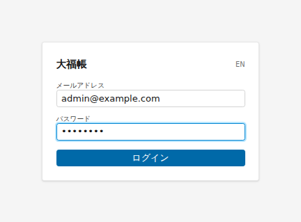
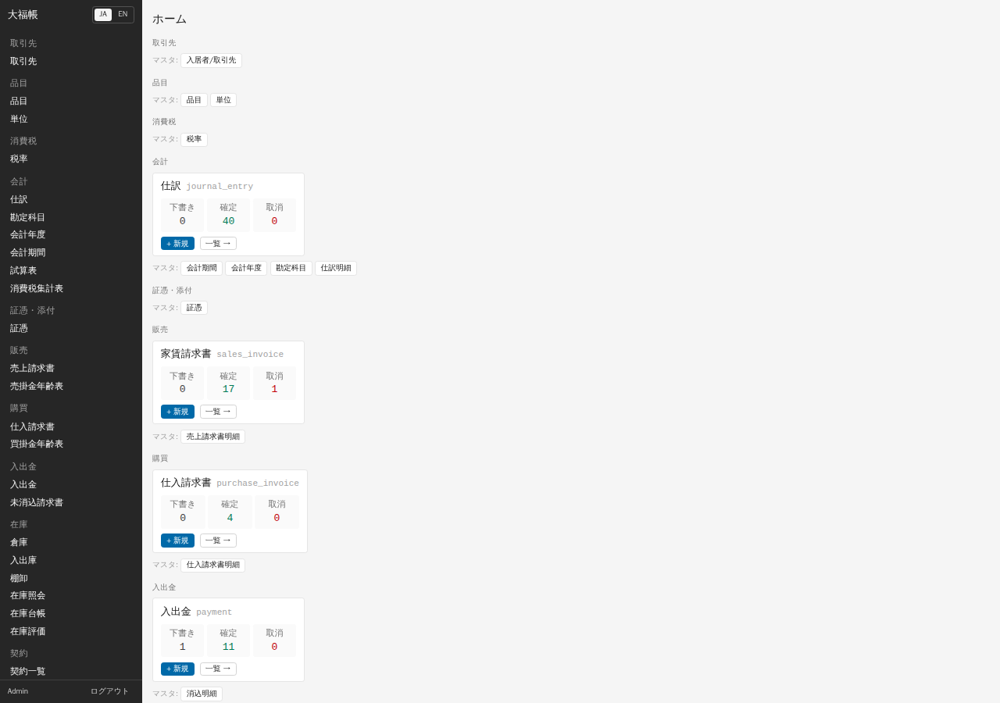
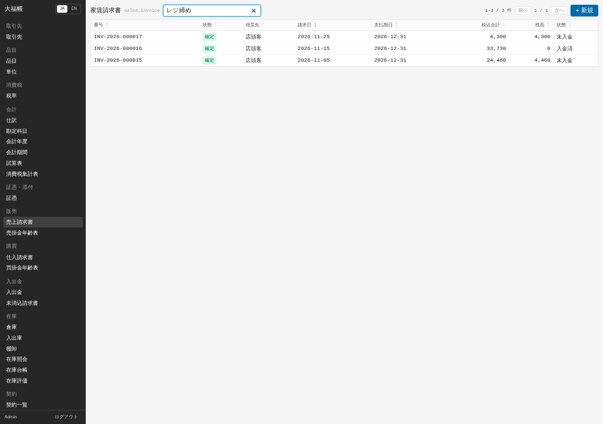
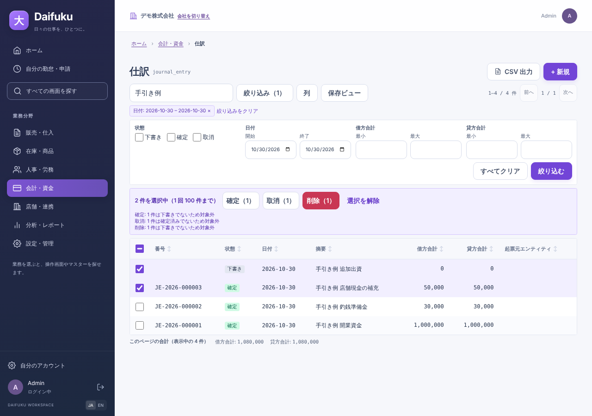
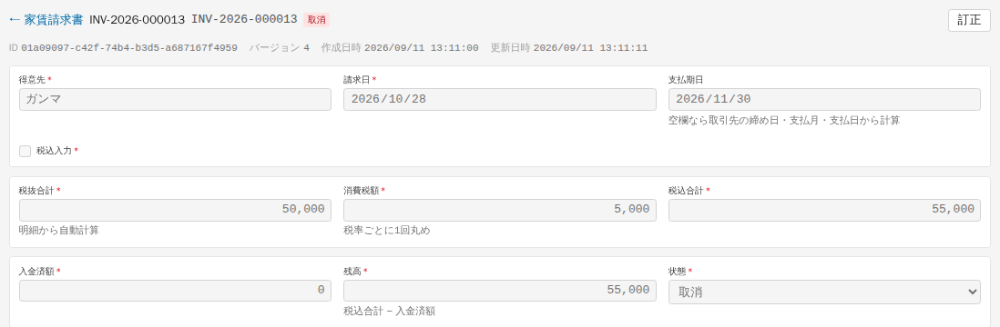
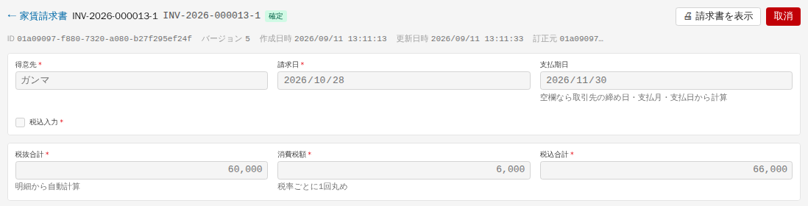
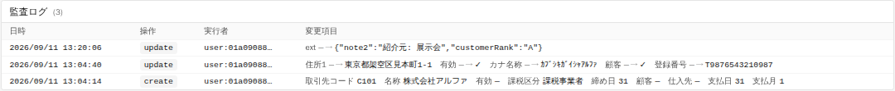
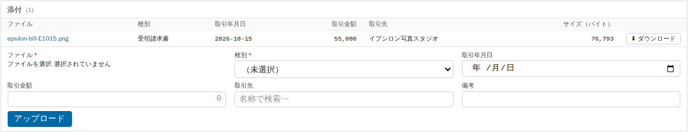
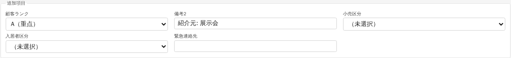
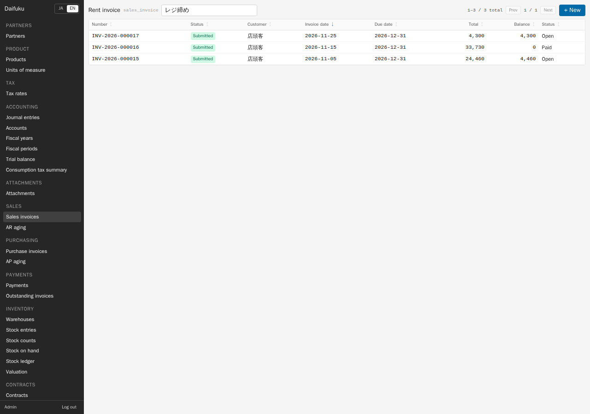

# 02 画面の基本

2026-09-13の業務分野・画面検索に合わせて導線を更新しました。画像は旧UIです。現在の入口は「[付録N](appendix-n-navigation.md)」、入力操作の変更点は「[付録C](appendix-c-ui-refresh.md)」を参照してください。

## ログイン

ブラウザで大福帳の画面（開発環境では `http://localhost:5173`）を開くと、ログイン画面が出ます。管理者から受け取ったメールアドレスとパスワードを入れて「ログイン」を押します。ログインは 12 時間有効で、切れると「セッションが切れました。再度ログインしてください。」と表示されてログイン画面に戻ります。

## 画面の構成

左側の藍色の帯が **サイドバー**（メニュー）です。ホーム、自分の勤怠・申請（利用可能な場合）、「すべての画面を探す」と、販売・仕入などの業務分野が並びます。分野を選ぶと、その目的に合う専用画面・マスター・記録を探せます。画面名が分かる場合は「すべての画面を探す」を使います。伝票の明細は親の伝票内で操作します。左上のロゴまたはホームへの項目でホームに戻ります。言語切替「JA / EN」、利用者名とログアウトは左下にあります。スマートフォンでは上部のメニューボタンでサイドバーを開きます。

**ホーム** では業務分野のカードから作業を始めます。承認・確認など自分が処理する仕事がある場合は、上部の「やること」カードに件数と急ぎの項目が表示されます（[付録N](appendix-n-navigation.md#やること受信箱で処理待ちを確認する)）。伝票件数を見る場合は「伝票の状況を確認」を開いてmoduleを選びます。そのmoduleの「下書き・確定・取消」件数を実際の記録から取得します。画面上部のパンくずから、ホーム・分野・一覧へ戻れます。

## 一覧画面

メニューから台帳を選ぶと一覧画面になります。

- **検索**: 見出しの右の「検索…」欄に文字を入れると、少し待ってから絞り込まれます。どの項目を検索するかは台帳ごとに決まっています（例: 品目はコード・名称・カナ、売上請求書は備考）。
- **並べ替え**: 列の見出しを押すと昇順、もう一度押すと降順になります。日本語の名称は読み（五十音）順ではなく文字コードの順に並びます。
- **ページ送り**: 1 ページ 50 件です。右上に「1–50 / 120 件」のように件数が出ます。
- **新規作成**: 右上の「+ 新規」。行を押すとその記録の画面が開きます。

### 絞り込み

検索欄の右の「絞り込み」を押すと、条件の欄が開きます（スマートフォンでも同じボタンで開閉します）。

- 伝票では「状態」（下書き・確定・取消）と業務日付（請求日・日付など）の範囲が先頭に出ます。そのほか一覧の列や検索対象の項目のうち、取引先などの参照・選択肢・金額や数量の範囲・はい/いいえの項目で絞り込めます。
- 条件を入れて「絞り込む」を押すと適用されます。日付の開始が終了より後、金額に数字以外を入れた場合などは、欄の下に理由が出て適用されません。「すべてクリア」で全部外します。
- 適用中の条件は表の上に「状態: 下書き ×」のような札で表示されます。札を押すとその条件だけ外れます。
- 条件はページの URL（`?f=`）に入るので、再読込・ブラウザの「戻る」・URL の共有でも同じ条件で開きます。月次締めガイドなどからの「`?status=draft&from=…&to=…`」のリンクも、状態と業務日付の絞り込みとして開きます。

### 列と保存ビュー

- **列**: 「列」で表示する列と順番（「↑」「↓」）を選び、「適用」を押します。「既定に戻す」で元の列に戻ります。伝票の「番号」と「状態」は常に先頭に出ます。
- **保存ビュー**: 「保存ビュー」で、いまの絞り込み・並べ替え・検索語・列に名前を付けて保存し、あとで「呼び出す」で同じ表示に戻れます（30 件まで、同じ名前は上書き）。
- 列と保存ビューは **このブラウザに、利用者・会社・台帳ごとに** 保存されます。別のパソコンや別の会社では共有されません。ブラウザの設定で保存できない場合は、既定の列で表示し、その旨を表示します。

### ページの合計

金額の列が表示されている台帳では、表の下に「このページの合計（表示中の 50 件）」として、表示中のページの金額列の合計が出ます。条件に一致するすべての行の合計ではありません（全体の合計はレポートで確認します）。

### CSV 出力

右上の「CSV 出力」で、いまの絞り込み・検索語・並べ替え・表示列の一覧を CSV（Excel で開ける UTF-8）で保存します。

- 押した時点の最新データを、出力の権限を確かめ直して取り出します。出力の権限がない利用者にはボタンが出ません。
- 1 回に出力できるのは **5,000 行まで** です。超える場合はボタンに「（先頭 5,000 件）」と出て、出力後に該当件数と上限が表示されます。条件を絞って分けて出力してください。
- 取引先などの参照は表示名、状態や選択肢は画面と同じ名前で出ます。ただし参照先の台帳（例: 取引先）を出力する権限がない利用者の場合、その列は表示名ではなく内部の id になります。`=` `+` `-` `@` で始まる文字は、表計算ソフトが式として実行しないよう先頭に `'` が付きます。
- 出力したことは監査ログ（台帳・条件・行数・実行者）に記録されます（現在は画面からは確認できません）。閲覧を制限された項目の値を条件にした場合、記録には値を伏せて残します。

### まとめて確定・取消・削除（伝票）

伝票の一覧では、行の左端のチェックボックスで複数の伝票を選べます（見出しのチェックボックスでそのページを全部選択）。条件を変えなければ、ページを移っても選択は残ります（100 件まで）。

1. 選ぶと表の上に「3 件を選択中」と、「確定（2）」「取消（1）」「削除（2）」のように操作ごとの対象件数が出ます。状態が合わない伝票（例: 確定済みの伝票は確定の対象外）は件数と理由が表示されます。
2. ボタンを押すと確認が出ます。実行すると 1 件ずつ順に処理し、「一括確定の結果」に行ごとの成功・失敗と理由が出ます。失敗した行があっても、成功した行は元に戻りません。失敗した伝票は結果のリンクから開いて直してください。
3. 実行中は次の一括操作を始められません。終わると一覧が更新されます。

取消の訂正日はまとめて指定できません。訂正日が必要な伝票は、伝票の画面から個別に取消してください。

## フォーム（入力画面）

- 項目は「基本」「連絡先」「振込口座」（取引先）、「請求」「金額」「入金」（売上請求書）のような見出し付きのまとまりに分かれます。スマートフォンなど幅の狭い画面で、見出しのあるまとまりが 4 つ以上ある画面では、まとまりがタブになります。タブを替えても入力した値は消えません。
- 項目名の横の赤い「*」は入力が必要な項目、「🔒」は作成後に変更できない項目です（例: 取引先コード）。項目の下の灰色の文は入力の説明です。
- 「保存」（キーボードでは Ctrl+S、Mac は ⌘+S）で保存します。「キャンセル」で一覧に戻ります。
- 入力に誤りがあると、フォームの上に「入力内容に N 件の問題があります」と一覧が出て、最初の誤りの欄にカーソルが移ります。一覧の行を押すとその欄へ移ります（タブの画面では、そのタブが開きます。誤りのあるタブには件数が付きます）。明細の誤りは「売上請求書明細 2 行目の単価」のように行と列で示します。各項目の下にも赤字で理由が出ます。
- 金額欄は、入力中はカンマなし、欄から出るとカンマ区切りで表示されます。
- 他の人が同じ記録を先に保存していた場合は「他のユーザーが先に更新しました」と出ます。「再読み込み」を押して最新の内容を表示してから入力し直してください。

### キーボード操作

フォームの下のバーの「?」で一覧を表示できます。

| キー | 動作 |
| --- | --- |
| Ctrl+S（Mac は ⌘+S） | 保存。ブラウザの「ページを保存」は開きません |
| Ctrl+Enter（Mac は ⌘+Enter） | 保存していない変更があれば保存。保存済みの下書き伝票では「確定」の確認を開きます |
| Enter（明細） | 次の欄へ。行の最後の欄では次の行、最後の行では行を追加 |
| Alt+↑ / Alt+↓（明細） | 行を上下に移動 |
| Ctrl+K（Mac は ⌘+K） | 画面と記録を検索 |

### スマートフォンでの保存と確定

幅の狭い画面では「保存」「確定」「キャンセル」がフォームの下端に固定されたバーに並びます。画面を下へ送らなくても保存・確定できます。確定は見出しの位置からこのバーへ移ります。

### 入力の一時保存と復元

保存していない入力は、このブラウザのタブの中に一時保存されます。再読み込みした・別の画面へ移った後で同じ画面を開くと「前回の未保存の入力が残っています。復元しますか？」と表示されるので、「復元する」か「破棄する」を選びます。

- 一時保存はタブの中だけです。他の端末や別のタブには引き継がれず、タブを閉じると消えます。12 時間たったものも使いません。
- 保存すると一時保存は消えます。ログアウトしたときもすべて消えます（ログインの期限切れで再ログインした場合は残ります）。
- 一時保存の後に他の人がその記録を更新していた場合は、古い入力を復元せず「この記録は前回の入力の後に更新されたため…」と表示します。最新の内容を見てから入力し直してください。
- 自動計算の項目や、権限の設定で一部の役割にだけ見える項目は一時保存しません。従業員・給与の記録は一時保存しません。

### 一覧の前後の記録へ移る

一覧から記録を開くと、見出しの上に「← 前の記録」「2 / 35 件」「次の記録 →」が出ます。一覧と同じ検索・絞り込み・並べ替えの順で隣の記録へ移ります（ページの境目も続けて移れます）。「← 一覧名」のリンクで、元の検索・絞り込みのまま一覧に戻ります。記録を直接開いた場合（リンク・検索・最近の記録から）は表示されません。

新規作成ではチェックボックスや選択肢の既定値が表示されます。例えば取引先の「有効」は最初からオンです。自動計算の合計・残高などは入力不要で、保存後に読み取り専用で表示されます。「税込入力」はその伝票に使う単価の税込・税抜に合わせて確認してください。

変更すると「未保存の変更」と表示され、保存するまで「確定」「取消」「削除」などは押せません。保存中も競合する操作を止めます。保存せずに別の画面へ移動する場合は確認されます（入力はタブに一時保存され、戻ると復元できます。下の「入力の一時保存と復元」）。閲覧権限だけの利用者には保存ボタンを表示しません。

## 明細グリッド

請求書や仕訳のように明細を持つ伝票では、フォームの下に表形式の明細欄が出ます。

1. 「+ 行を追加」で行を足します。欄で Enter を押すと同じ行の次の欄へ、行の最後の欄では次の行へ移り、最後の行の最後の欄で Enter を押すと行が増えます。品目などの候補欄は、文字を入れていなければ Enter で次の欄へ進みます。
2. 品目・勘定科目などは、欄に文字を入れると候補が出るので選びます。品目を選ぶと、登録済みの品名・単価・税区分・単位が対応する欄に補われます。数量と今回の取引条件を確認してください。
3. 行の右端の「↑」「↓」（キーボードでは Alt+↑ / Alt+↓）で順番を入れ替え、「×」で行を削除します。
4. 表の下の「合計」は画面上での足し算で、「参考値」です。正式な金額は保存したときにシステムが計算します。

ヘッダと明細は「保存」1 回でまとめて保存されます。

## 伝票の状態（下書き・確定・取消・訂正）

請求書・入出金・仕訳・入出庫・棚卸・契約などの **伝票** には状態があり、見出しの横に色付きの札で表示されます。

| 状態 | 意味 | できる操作 |
|---|---|---|
| 下書き | 保存しただけ。帳簿には反映されない | 編集、「確定」、「削除」 |
| 確定 | 帳簿に反映された。伝票番号が付く | 「取消」（仕訳を除く） |
| 取消 | 確定を取り消した。記録は残る | 「訂正」 |

- **確定** すると伝票番号（例 `INV-2026-000012`）が付き、ほとんどの項目と明細が変更できなくなります。売上・仕入の請求書や入出金は、確定した時点で仕訳が自動で作られます。
- **確定した伝票は削除できません。** 誤りに気づいたら「取消」してから「訂正」します。取消すと自動で作られた仕訳も逆向きの仕訳で打ち消されます。
- **訂正** を押すと、取り消した伝票の内容を写した新しい下書きができます（見出しの下に「訂正元」）。直して確定すると、元の番号に「-1」が付いた番号（例 `INV-2026-000013-1`）になります。
- 入金済みの請求書は取消できません。先に入金を取消してください。
- 「取消」の確認画面には「訂正日（任意）」があります。空欄は元の取引日での取消です。元の期間が締まっている場合は、開いている期間の訂正日を指定して「取消」を押します。
- **仕訳は取消できません。**「取消」ボタンは表示されますが、押すとエラーになります。訂正は「逆仕訳」で行いますが、v0.1 では画面から逆仕訳を作れないので、管理者に依頼してください（「[09 AI から使う](09-ai.md)」の `accounting.reverse_entry`）。

## 複製と「関連」

### 複製

記録の画面の右上の「複製」を押すと、その記録の内容を入れた新規画面が開きます。毎月ほぼ同じ請求書を作るときなどに使います。新規作成の権限がある記録だけに表示されます。

- 持ち越すのは自分で入力する項目と明細です。伝票番号・状態・合計や残高などの自動計算値・仕訳との連動・訂正元・取引先コードのように重複できない項目は持ち越しません。仕入請求書の「先方請求書番号」も、その 1 通の請求書を指す番号なので持ち越しません（空欄になります）。
- 「請求日」「日付」のように既定値が今日の日付は今日になり、「支払期日」などほかの日付は空欄になります（支払期日は保存時に取引先の支払条件から計算されます）。元の日付はフォームの上のお知らせに表示されます。
- **保存するまで何も作られません。** 内容を直して「保存」を押すと、新しい下書きになります。保存せずに離れれば何も残りません。
- 押したときに元の記録を読み直します。表示した後に誰かが更新していた場合は新規画面を開かず、「この記録は表示した後に更新されました」と出して最新の内容を表示します。確認してからもう一度押してください。権限がなくなったなどで読み直せない場合も、新規画面を開かずに理由を表示します。

### 関連

記録の画面のフォームの下に「関連」欄があり、その記録とつながっている記録を種類ごとに表示します。番号や名前を押すとその記録へ移動します。

- **参照先**: この記録が指している記録（請求書の取引先、確定時に作られた仕訳など）。明細が指している品目なども含みます。明細が別の伝票の明細を指しているとき（出荷の明細が受注の明細を指すなど）は、その伝票を表示します。
- **参照元**: この記録を指している記録（請求書を消し込んだ入出金、請求書を起票元とする仕訳など）。この記録の明細を指している伝票も含みます。
- 各記録の後ろに、どの項目でつながっているか（「取引先」「統制勘定」「勘定科目」など）を表示します。
- **訂正元 / 訂正版**: 取消して訂正した伝票の前後の版。訂正元・訂正版をそれぞれ最大 50 段までたどって表示します。
- 読み取りの権限がある記録だけを表示します。権限のない種類は欄そのものに出ません。
- 種類ごとに最大 50 件です。それより多いときは「最初の 50 件を表示しています」と出ます。
- 逆仕訳のように 2 段先の記録は、仕訳の画面の「関連」でたどります。
- 「関連」の読み込みに失敗しても、フォームはそのまま使えます。欄の「再試行」で読み直します。「技術情報」を開くとエラーコードなどを確認できます。
- 保存や確定のあと、「関連」は裏で読み直します。保存の完了は「関連」の読み込みを待ちません。

## 監査ログ

記録の画面のいちばん下に「監査ログ」があります。いつ・誰が・どの操作（作成 create、更新 update、確定 submit など）で・どの項目をどう変えたかが、新しい順に並びます。監査ログは誰にも消せません。実行者欄は現在、利用者名ではなく内部の ID（`user:…`）で表示されます。AI エージェントが操作した場合は `agent:` と表示されます。

## 添付（証憑）

記録の画面の「添付」欄から、請求書や領収書のファイルをその記録に結び付けて保存できます。

1. 「ファイル」でファイルを選びます（PDF・PNG・JPEG・CSV・XML・テキスト、20 MB まで）。
2. 「種別」（受領請求書、発行請求書、領収書、契約書、銀行明細、その他）を選びます。
3. 電子帳簿保存法の検索に使うため、「取引年月日」「取引金額」「取引先」も入れておきます。
4. 「アップロード」を押します。一覧の「ダウンロード」で取り出せます。

同じ内容のファイルを二度アップロードすると、重複としてエラーになります。**保存した証憑は削除できません**（管理者も同じ）。差し替えは管理者が「訂正版で差し替え」（`attachment.supersede`）で行い、古いファイルも残ります。

## 追加項目

導入テンプレートなどが足した項目は、フォームの下の「追加項目」の枠にまとめて表示されます。使い方は通常の項目と同じです。

## 言語の切替（JA / EN）

サイドバー下部の「JA」「EN」で、メニュー・項目名・ボタンの言語を切り替えます。入力したデータ（取引先名など）は切り替わりません。レポートの標準的な条件名は日本語で補完されますが、帳票が独自に指定した名称や一部の設定項目は、日本語表示でも英語の場合があります。

---

検証: 2026-09-11 実機で確認 — ログイン、ホーム、一覧の検索・見出しでの並べ替え（昇順/降順）・件数表示、フォームの保存と入力エラー表示、同時更新時の「他のユーザーが先に更新しました」、新規作成でチェックボックスがオフのまま保存されること（取引先「有効」）、明細グリッドの行追加・Enter での行追加、確定・取消・訂正（番号 `-1`）、取消による仕訳の打ち消し（試算表で確認）、入金済み請求書の取消拒否（API）、確定済み請求書の削除拒否（API）、仕訳の「取消」がエラーになること、監査ログ、添付のアップロード・重複エラー・削除拒否（API）、追加項目の保存、JA/EN 切替。未検証: セッション切れの表示、20 MB の上限、許可されないファイル形式、`attachment.supersede`。

検証（一覧の絞り込み・列・保存ビュー・合計・CSV・一括操作）: 2026-10-29 ブラウザ試験 `apps/web/e2e/list-workbench.spec.ts`（合成の仕訳、1280px と 390px）で確認 — 状態と日付の絞り込みと URL の再読込・戻る、`?status=draft&from=&to=` のリンク、札での解除、不正な URL 条件の無視、列の変更・既定に戻す、保存ビューの保存・呼び出し・削除、ページ合計、CSV の中身（BOM・見出し・式の無効化）、閲覧者に CSV と選択欄が出ないこと、3 件の一括確定で 1 件失敗の表示と実行中の二重実行防止。未検証: 5,000 行を超える出力の画面表示（上限そのものは DB 試験で確認）、Web Locks の無いブラウザでの保存、ref・enum・bool の絞り込み欄の画面操作（変換は単体試験）。
