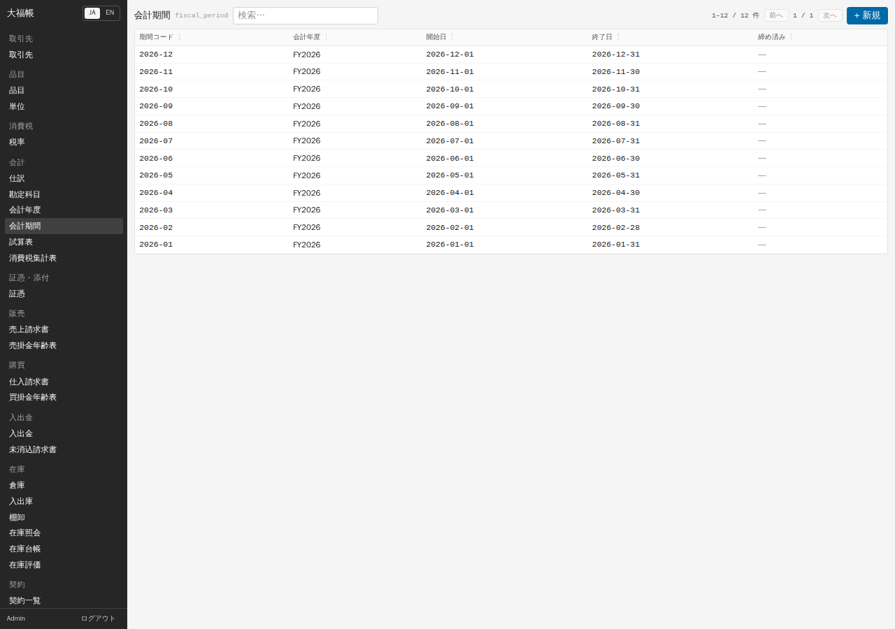
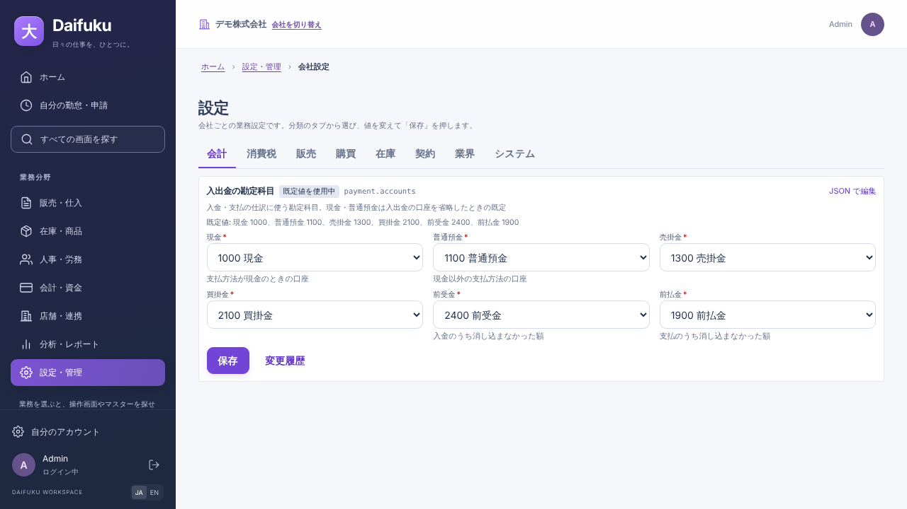
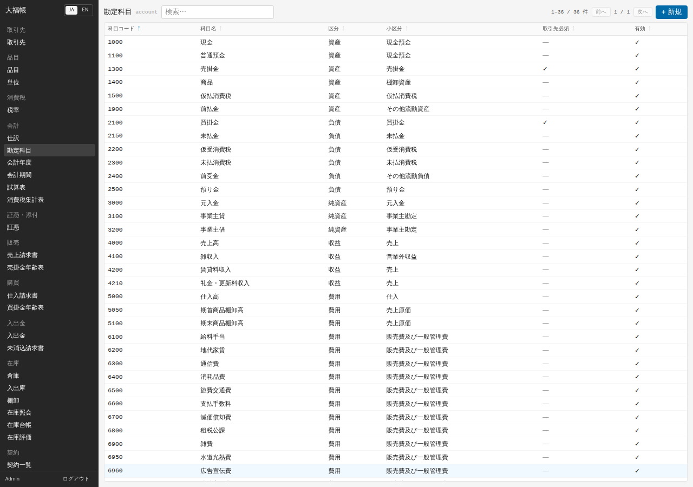
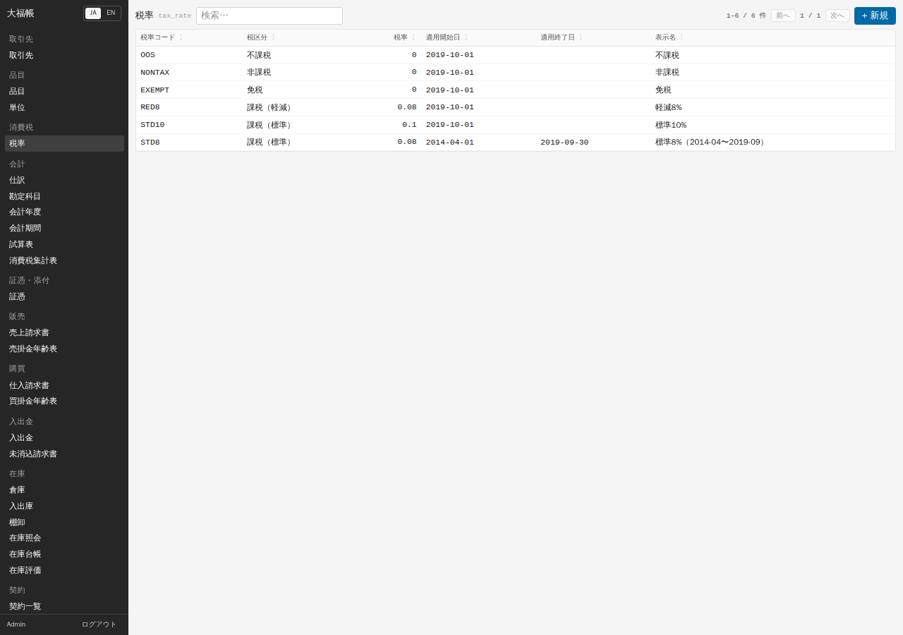

# 03 初期設定

2026-09-12追補: 新規導入・既存環境の更新は [安全な導入と更新](../operations/setup.md)、利用者/会社/店舗の設定は [付録E](appendix-e-operations-control.md) を参照してください。本章のデモ初期化は練習専用で、既存データを残す更新手順ではありません。

使い始める前に、会社情報・会計年度・勘定科目・税率と端数処理・請求書の発行者・在庫の扱い・業界テンプレート・利用者・勤怠給与の制度を整えます。会社の管理者は、まず「設定・管理」→「セットアップ」の**セットアップウィザード**（下記）で順に進めてください。ウィザードは各段階の完了を実際のデータで確かめ、途中でやめても次に開いたときに続きから進められます。設定漏れを一覧で点検するだけなら「設定・管理」→「導入チェック」も使えます（「[08 管理者向け](08-admin.md#導入チェック)」）。`pnpm db:reset` で作ったデモ環境や「会社の管理」で作った会社には日本向けの初期値が入っているので、多くの段階は最初から完了しています。

この章の後半（会計年度・設定画面・勘定科目・税率・会社プロフィール・発行者情報）は、ウィザードの各段階で使う画面と設定の詳しい説明です。

## セットアップウィザード

「設定・管理」→「セットアップ」（アドレス `/setup`）を開きます。会社の管理者（admin の役割で、店舗・拠点に限定されない所属）だけが使えます。管理者でない利用者には画面の一覧に出ず、アドレスを直接開くと「セットアップは会社の管理者だけが使えます」と表示されます。ホームには、管理者に限り、未完了の段階が残っている間「セットアップを続ける」カードが出ます（次の段階の名前と完了数。カードの「セットアップを開く」で続きの段階が開きます）。

左（狭い画面では上）の段階一覧から段階を選びます。各段階の状態は「完了」「未完了」「スキップ」の文字と色で示され、勤怠・給与は「任意」です。上には「8 段階中 5 段階完了、スキップ 1」のように進み具合が出ます。段階一覧はキーボードの ↑ ↓（← →）で隣へ、Home / End で先頭・末尾へ移り、Enter で開けます。

| # | 段階 | 完了の条件（実データ） | ここで行うこと |
|---|---|---|---|
| 1 | 会社情報 | 会社プロフィールに正式名称がある | 「会社プロフィール」の枠を入力して保存（下の「会社プロフィール」） |
| 2 | 会計年度 | 今日を含む開いた会計期間があり、30 日後の期間もある | 今日を含む年度の確認。無いとき・30 日以内に尽きるときは提案された年度を「この年度を作成」で作る |
| 3 | 勘定科目の確認 | 有効な科目があり、仮受消費税・仮払消費税の役割の科目がそれぞれある | 件数の確認と、勘定科目の一覧へのリンク（何も保存しない） |
| 4 | 税率と端数処理 | 今日に有効な標準税率がある | 端数処理・税込入力の枠（「1 つの適格請求書につき税率ごとに 1 回」丸める） |
| 5 | 請求書の発行者 | 名称と登録番号を印字できる（免税事業者は番号不要） | 「会社プロフィールから複写」で発行者の欄を埋めて保存、または保存せずプロフィールを印字 |
| 6 | 在庫の扱い | 自動入出庫を使わない、または既定の倉庫と有効な物品がある | 「在庫を使う／在庫を使わない」を選んで保存 |
| 7 | 業界テンプレート | 業界テンプレート（見本の example を除く）を適用済み | テンプレートの「この会社に導入」、または理由を書いてスキップ |
| 8 | 利用者 | この会社に所属する有効な利用者が 2 人以上 | 利用者の追加・招待と、この会社への所属の設定（テナント管理者だけ） |
| 9 | 勤怠・給与（任意） | 勤怠・給与の制度がある | 制度が無いときだけ「初期制度を準備」 |

- 各段階の保存は、それぞれの画面と同じ仕組み（会社設定の保存、会計年度の作成、テンプレートの適用、利用者の作成）で行われ、その権限の確認もそのまま行われます。保存のあと状態を取り直します。「再点検」で最新の状態に更新できます。
- 段階が「完了」のときは「確認して次へ」で確認を記録して次の段階へ進みます（記録は「確認日時」として出るだけで、完了かどうかは常に実データで決まります。以前確認した段階が条件を満たさなくなると「以前は完了していましたが、条件を満たさなくなりました」と出ます）。「次へ」「前へ」は記録せずに移ります。
- 「未完了」の段階は「スキップ…」で理由（必須、200 文字まで）を書いて「スキップを記録」できます。スキップした段階は一覧に「スキップ」と理由が残り、ホームのカードの残りには数えません。ただし伝票を確定できない状態（会計期間が無い・標準税率が無い・倉庫が決まらないなど、点検が「要対応」）の段階は、スキップしてもホームのカードに警告として残ります。「スキップを取り消す」で記録を消せます。
- 入力中の段階から別の段階や画面へ移ろうとすると「未保存の変更があります。破棄して移動しますか？」と確認が出ます。
- **会計年度の提案**: 決算月は段階 1 の会社プロフィールで入れます（未設定なら 12 月決算として提案）。今日を含む年度が無いときは、前の年度の続き（前の年度の翌日から 12 か月）が今日を含めばそれを、そうでなければ決算月の翌月から始まる 12 か月を提案します。新しい会社には当年 1〜12 月の年度が最初から作られるので、決算月が 12 月以外の会社では「開始月が決算月の翌月と違う」と注記されます。既存の年度は変更・削除しません。前の年度との間が空くと「その期間の日付の伝票は確定できない」と注記され、既存の年度と重なる提案は作成できません。
- **在庫の扱い**: 物品を仕入れて売る会社（例: 小売・卸売・電器店・農家・飲食チェーンのテンプレート）は「在庫を使う」、役務・賃貸・工事などを請求する会社は「在庫を使わない」が目安です（決まりではありません）。「在庫を使う」を保存した会社では、マイナス在庫を許可しない設定（既定）のため、物品の売上請求書を確定する前に入庫が必要です（入庫伝票か、在庫タブでマイナス在庫の許可）。
- **利用者**: 招待メールで招いた人は、受理して所属が割り当てられるまで数えません。所属は受理後に「利用者と権限」で割り当ててください（受理前に所属を付けると招待を再発行できません）。テナント管理者でない会社の管理者には、利用者の追加はテナント管理者が行う旨だけが出ます。
- 新しい会社を「会社の管理」で作ったときは、作成後の「切り替えてセットアップを始める」でこの画面が開きます（「[08 管理者向け](08-admin.md#会社の追加と編集)」）。
- 設定画面の「システム」タブの「セットアップの進捗」は、確認とスキップの記録です。設定画面では編集できず、「セットアップで変更」のリンクだけが出ます。

## 会計年度と会計期間

会計年度は 12 か月の「年度」と、月ごとの「会計期間」でできています。初期状態では当年 1 月〜12 月の年度（`FY2026`）と 12 の会計期間が作られています。「会計・資金」から「会計期間」を探して確認できます。

- 仕訳（請求書などから自動で作られる仕訳を含む）は、日付が **開いている会計期間** に入っていないと確定できません。
- 翌年度の年度と期間は、管理者がセットアップウィザードの「会計年度」の段階（上記）で作ります。中身は `accounting.open_fiscal_year`（開始日を指定）で、開始月は 1 月以外でもかまいません。既存の年度と期間が重なる場合は拒否されます。AI から作る方法は「[09 AI から使う](09-ai.md)」を見てください。
- 月の締め方は「[06 月次](06-monthly.md)」を見てください。

## 設定画面

「設定・管理」→「会社設定」（管理者か settings ロールの利用者のみ。店舗・拠点に限定された所属では開けません）で、会社ごとの設定を変えます。「すべての画面を探す」でも検索できます。

- 上のタブ（会社・会計・消費税・販売・購買・在庫・契約・業界・システム）で分類を選びます。設定が無い分類のタブは出ません。選んだタブはアドレス（`/settings?tab=sales` など）に残るので、ブックマークや再読込でも同じタブが開きます。タブはキーボードの ← → で隣へ、Home / End で先頭・末尾へ移れます。
- 設定ごとに枠があり、細目は日本語の名前で並びます（英語表示では英語の名前）。値を変えて枠の中の「保存」を押すと反映され、「設定を保存しました」と出ます。
- 勘定科目の欄は、有効な勘定科目から「コード 名称」（例: `4000 売上高`）で選びます。倉庫の欄も倉庫の一覧から選びます。保存されているコードが科目・倉庫に無いときは「（見つかりません）」と警告が出るので、正しい科目を選び直してください。科目が 500 件を超える会社では一覧に先頭 500 件だけが並び（「先頭 500 件だけを表示しています」と出ます）、一覧に無い保存値は 1 件ずつ確かめてから警告します。
- 省略できる欄（例: 業界タブ「賃貸管理の勘定科目」の「敷金の入出金口座」）には「指定しない」の選択肢があり、選んで保存すると省略時の扱い（この例では入出金の勘定科目の普通預金）になります。
- まだ作っていない科目・倉庫のコードを先に設定したいときは、一覧の末尾の「コードを直接入力…」を選ぶと入力欄に変わります（「一覧から選ぶ」で戻ります）。保存後、そのコードの科目・倉庫を作るまでは警告が出ます。
- 科目・倉庫を参照する権限が無い利用者（settings ロールだけの利用者など）には、「参照する権限が無いため、コードを直接入力してください」と出て、コードを直接入力する欄になります。
- はい／いいえの設定はチェックボックス、選択肢のある設定は日本語の選択肢、住所・振込先は複数行の入力欄です。
- 会社がまだ値を保存していない枠には「既定値を使用中」と表示され、「既定値: 売掛金 1300、売上高 4000、…」のように、システムが実際に使う値が出ます。入力欄も既定値から始まります。
- 値を保存した枠には「会社の値」と出て、「既定に戻す」で保存値を消せます（確認の画面で「既定に戻す」を押すと実行、「戻る」か Esc で取りやめ）。保存されている値が設定の定義に合わなくなったときは、枠に「定義に合わない値」と警告が出て、既定値（既定値の無い設定では未設定の扱い）が使われます。保存し直すか既定に戻してください。
- **業種テンプレートを入れた会社の注意**: テンプレートの適用で入った値（例: 賃貸管理の「売上転記の勘定科目」の売上高 4200 賃貸料収入）も「会社の値」です。「既定に戻す」を押すと、テンプレートの値ではなくシステムの既定値（売上高 4000）に戻ります（確認の画面にも注意が出ます）。テンプレートの値に戻すには、その値を選び直して保存してください（管理者はテンプレートの再適用 `pnpm pack:apply <名前> --force` でも戻せますが、そのテンプレートの設定すべてが上書きされ、初期データの投入も再実行されます）。
- 「変更履歴」を押すと、その設定の直近 20 件の変更（日時・操作者・変わった細目の「変更前 → 変更後」）が新しい順に出ます。「既定に戻す」も履歴に残ります。会社に値が無かった側は「既定値（4000）」のように、そのとき使われていた既定値で表示します（既定値の無い設定は「未設定」）。AI エージェント経由の変更は「agent:<エージェント名>（<利用者> の代理）」と表示されます（名前が 12 文字を超えると先頭 8 文字）。エージェント名は呼出し側が名乗った文字列なので、利用者の名前としては扱いません。

| 設定（タブ） | 意味 | 日本向けの初期値 |
|---|---|---|
| 会社プロフィール（会社） | 正式名称・郵便番号・住所・電話・メール・登録番号（`T`+13 桁）・課税／免税・決算月・代表者名。請求書の発行者が未設定のときの印字元（下記） | 未設定 |
| 消費税の端数処理（消費税） | 税額を「税率ごとに 1 回」丸める方法（切捨て / 四捨五入 / 切上げ）と丸める単位（請求書ごと。納品書ごとは未対応） | 切捨て・請求書ごと |
| 税込入力（消費税） | 請求書の単価を税込で入力するかの既定（チェックボックス）。各伝票のチェックも確認する | 税抜（チェックなし）。小売の税込運用では導入時にチェックを入れて保存（通常のテンプレート適用は保存済み設定を維持） |
| 請求書の発行者（販売） | 適格請求書に印字する名称・登録番号など（下記） | 未設定（会社プロフィール、無ければ会社名を印字） |
| 売上転記の勘定科目（販売） | 売上請求書の確定時に使う科目（売掛金・売上高・仮受消費税） | 1300 / 4000 / 2200 |
| 仕入の転記科目（購買） | 仕入高・買掛金・仮払消費税の科目 | 5000 / 2100 / 1500 |
| 入出金の勘定科目（会計） | 現金・普通預金・売掛金・買掛金・前受金・前払金の科目 | 1000 / 1100 / 1300 / 2100 / 2400 / 1900 |
| 既定の倉庫コード（在庫） | 自動入出庫や倉庫を省略した伝票の倉庫 | MAIN |
| 仕入請求書から自動入庫 / 売上請求書から自動出庫（在庫） | 物品の請求書を確定したとき在庫を自動で動かすか | どちらも する |
| マイナス在庫を許可（在庫） | 在庫が足りないときに出庫を許すか | 許可しない |
| 契約の日割り（既定） / 契約請求書を自動で確定（契約） | 継続契約の既定 | 日割り（当月の実日数） / しない |
| 定期仕訳を生成と同時に確定（会計） | 定期仕訳の生成で作った仕訳をその場で確定するか（[06](06-monthly.md#定期仕訳を生成する)） | しない（下書きのまま） |
| 業種テンプレートの設定（業界） | 小売の月次締めの科目、賃貸管理の科目、業種別の請求後支払日数など。テンプレートを入れた会社で使う | テンプレートごとの既定値 |
| 適用済みパック（システム） | テンプレート適用の記録（JSON）。通常は変更しない。記録を消すとその会社でテンプレートの業務が働かなくなるため、「既定に戻す」は出ない | 適用時に自動で記録 |
| セットアップの進捗（システム） | セットアップウィザードで確認・スキップした段階の記録。ここでは編集できず、管理者には「セットアップで変更」のリンク、settings ロールには「会社の管理者がセットアップの画面で変更します」と出る | 未設定 |

**在庫を使わない業種の場合**（デザイン事務所など）: 物品の品目を売上請求書に使うと、在庫が無いため確定できません。「在庫」タブの「仕入請求書から自動入庫」と「売上請求書から自動出庫」のチェックを外して保存するか、在庫を先に入庫してください。

## 勘定科目

「会計・資金」→「勘定科目」に、中小企業向けの科目表（現金 1000、普通預金 1100、売掛金 1300、商品 1400、仮払消費税 1500、買掛金 2100、仮受消費税 2200、預り金 2500、元入金 3000、売上高 4000、仕入高 5000、地代家賃 6200、外注費 6980 など）が入っています。

科目を足すときは「+ 新規」で、コード（後から変更不可）、名称、区分（資産・負債・純資産・収益・費用）、既定の税区分、「消費税の役割」を入れます。「消費税の役割」は、仮受消費税の科目だけ「仮受消費税（売上税額）」、仮払消費税の科目だけ「仮払消費税（仕入税額）」にし、他は「なし」にします。消費税集計表はこの印を見て税額を集めます。売掛金・買掛金のように「取引先必須」にチェックが入った科目は、仕訳の明細で取引先を入れないと確定できません。

## 税率

「消費税」→「税率」に、税区分ごとの率と適用期間が入っています（標準 10%、軽減 8%、非課税・免税・不課税は 0%、2019-09-30 までの標準 8%）。税率は「期間付きのデータ」で、請求書の日付に有効な率が使われます。

税率が改正されたときは、古い行の「適用終了日」を入れ、新しい率の行を「適用開始日」付きで足します。なお、2027 年 4 月からの飲食料品 1% は、2026-09-10 時点で閣議決定のみ・法案未成立の情報で、初期データには入っていません。

## 締め日と支払条件

請求書の「支払期日」は、取引先ごとの「締め日」「支払月」「支払日」から自動で計算されます（「[04 マスタ](04-masters.md)」）。

- 月末締め翌月末払い: 締め日 31、支払月 1、支払日 31（初期値）
- 20 日締め翌月 10 日払い: 締め日 20、支払月 1、支払日 10。10 月 20 日の請求書の支払期日は 11 月 10 日になります。
- 当月末払い（家賃など）: 締め日 31、支払月 0、支払日 31

請求書の「支払期日」を手で入れた場合は、その日付が優先されます。

## 会社プロフィール

「設定」の「会社」タブの先頭にある「会社プロフィール」に、会社の基本情報（正式名称、郵便番号、住所、電話番号、メールアドレス、適格請求書の登録番号、消費税の課税区分、決算月、代表者名）を入れます。どの欄も省略できます。

- 登録番号は `T` と数字 13 桁です。形式が違うと保存できません。課税区分を「免税事業者」にした会社には登録番号を入れられません（登録番号は適格請求書発行事業者＝課税事業者だけが持つため）。
- 正式名称を空にすると、請求書などでは会社名（「会社の管理」で付けた名前）を使います。
- 新しい会社は「設定・管理」→「会社の管理」で作ります（「[08 管理者向け](08-admin.md#会社の追加と編集)」）。作った直後は会社プロフィールが空なので、セットアップウィザードの段階 1 で最初に入れてください。

## 期首残高の取込

他のシステムや手書きの帳簿から移るときは、利用開始の会計年度の **期首時点の残高** を「会計・資金」→「期首残高の取込」（`/finance/opening`、画面検索でも見つかります）で取り込みます。CSV ファイルを 3 段（1 開始仕訳、2 売掛金・買掛金、3 在庫）で選び、「事前確認」で結果を確かめてから「取り込む」を押します。事前確認では何も変更しません。仕様は [opening-balances](../specs/opening-balances.md)、制度の根拠は [docs/domain/opening-balances.md](../domain/opening-balances.md) です。

### 前提

- 取り込めるのは **会社の最初の会計年度** だけです。それより前の年度がシステムにあれば、その残高が試算表の期首欄にそのまま繰り越されるので取り込みません。
- すべての期首伝票の日付は **期首日の前日（期首残高日）** です（例: 2026-04-01 始まりの年度なら 2026-03-31）。この日はどの会計期間にも入らないため、試算表の期首欄にだけ現れます。最初の会計期間か年度を締めると取り込めません（再開すれば取り込めます）。
- **期首残高仮勘定**（l10n/jp の科目表では `3900 期首残高仮勘定`、純資産）が必要です。科目が無い、無効、損益の科目、取引先必須、税の役割がある科目のときは取り込めません（画面の状況に理由と設定画面へのリンクが出て、開始仕訳・売掛金・買掛金の段は無効になります。在庫の段は仮勘定を使わないので取り込めます）。3900 が無い以前からの会社は、科目を作るか、「設定」の「会計」タブの「期首残高の取込」で科目コードを変えます。
- 役割: 画面と 4 つの取込は **経理か管理者** だけが使えます。さらに、売掛金は売上請求書を作れる役割（営業か管理者）、買掛金は仕入請求書を作れる役割（購買か管理者）、在庫は入庫できる役割（在庫・購買か管理者）と品目を読める役割（閲覧・営業・購買など。在庫・経理の役割だけでは品目を読めません）も要ります。経理だけの利用者は開始仕訳だけを取り込めます。管理者が行うか、一時的に営業・購買・在庫の役割を足してください（取込のために役割の範囲を広げる仕組みはありません）。

### CSV の列

各段の「雛形をダウンロード」で、見出しだけの CSV（UTF-8 BOM 付き）が取れます。見出しは日本語・英語のどちらでも、項目名（`accountCode` など）でもかまいません。知らない列・必須の列の欠落・同じ列の重複があるファイルは読み込みません。金額はカンマ・全角数字でもかまいません（円単位）。

| 段 | 列（太字は必須） | 1 行の意味 |
|---|---|---|
| 1 開始仕訳 | **科目コード**、取引先コード、**借方**、**貸方**、摘要 | 試算表の貸借対照表の科目の期首残高（借方か貸方の片方）。最大 1,000 行（受け付けた行は 500 行まで） |
| 2 売掛金・買掛金 | **取引先コード**、**金額**、支払期日、元請求書番号、元請求日、備考 | 取引先ごとの未入金・未払の残高。1 行が 1 件の期首請求書。最大 200 行（多いときはファイルを分けます） |
| 3 在庫 | 倉庫コード（空なら既定の倉庫）、**品目コード**、**数量**、**単価** | 品目 × 倉庫ごとの期首数量と単価（小数 6 桁まで）。最大 2,000 行 |

- 取引先・品目はコード、無ければ名称の完全一致で探します（同じ名称が複数あればコードで指定します）。`$ctx.` で始まる値は使えません。
- 開始仕訳には損益の科目（売上・費用）を入れません。前期の損益は繰越利益剰余金（個人事業者は元入金）に含めた残高を入れます。個人事業者の **事業主貸・事業主借は翌年の期首に残高を持たない** ので入れないでください（システムは区分 `equity` の科目を検査しません）。
- 支払期日が空の行は、元請求日があればそれを、無ければ期首残高日を基準に、取引先の締め日・支払条件から計算します。年齢表の期日区分はこの支払期日で決まります。

### 順番と期首残高仮勘定

1. **開始仕訳**: 試算表どおりに入れてかまいません。取引先を空けた売掛金・買掛金（取引先必須の科目）の合計行は、自動で期首残高仮勘定に計上されます（事前確認の行の状態「仮勘定へ」）。
2. **売掛金・買掛金**: 期首請求書（不課税の明細 1 行、期首残高日付）が「売掛金 ／ 期首残高仮勘定」「期首残高仮勘定 ／ 買掛金」を転記し、取引先別の残高に振り替えます。期首請求書は通常の請求書と同じく入金・支払の消込、年齢表、受信箱の期日超過の対象です。取引先へ交付する書類ではないので、期首請求書の画面には「請求書を表示」（適格請求書）が出ません。
3. **在庫**: 期首残高日付の入庫（会計年度に紐づく入出庫伝票）を倉庫ごとに作り、単価を移動平均の最初の単価にします。仕訳は作りません（在庫科目の期首残高は 1 の開始仕訳に入れます）。

全部の取込が一致すれば、状況の「期首残高仮勘定」の残高は **0** になります。0 でないときは、画面が仮勘定へ回した科目を示すので、開始仕訳の合計行と売掛金・買掛金の CSV の合計を見比べてください。順番は 1 → 2 → 3 を勧めますが、どの順でも合計で一致します。

### 取消と再取込

確定した期首伝票は編集しません。直すときは取り消して取り込み直します。

- 開始仕訳: 画面の「開始仕訳を取り消す」（期首残高日付の逆仕訳）の後、もう一度取り込みます。未取消の開始仕訳があるうちは取り込めません。
- 期首請求書・期首在庫の入庫: 状況の「一覧を開く」から、通常の「取消」で取り消します（一覧の一括取消も使えます）。**訂正日を指定せずに（期首残高日付で）取り消した** 取引先・品目 × 倉庫だけが取り込み直せます。
- 期首請求書を期中に入金・消込した後で消込を外し、期中の訂正日で取り消した場合、その取引先は取り込み直せません（期中の逆仕訳が残るため、取り込み直すと期首欄が二重になります）。期中の通常の請求書か仕訳で残高を直してください。期首在庫を期中の日付で取り消した品目 × 倉庫も、以後は取り込めません。
- 取り消した期首請求書には「訂正」が出ません（訂正で複製した下書きは通常の請求書として計上されてしまうため、確定もできません）。期首残高の取込で作り直してください。
- 誤って最初にした年度より前の年度を開くには、その年度の開始仕訳と期首請求書をすべて期首残高日付で取り消し、期首在庫の入庫もすべて取り消してください（仕訳の残高が 0 になり、確定済みの期首在庫の入庫が無ければ開設できます。残っていると、開設は「opening_entries_exist」または「opening_stock_exists」で拒否されます）。

### 期中から使い始めるとき

取り込めるのは年度の期首時点の残高だけです。年度の途中（例: 4 月始まりの年度の 10 月）から使い始めるときは、期首時点の残高を取り込み、経過した月は開いている会計期間に月ごとの集約仕訳で入れます。経過した月に発生して導入時点で未決済の売掛金・買掛金は、期中の通常の請求書（または取引先付きの集約仕訳）で入れてください。

### 小売パック（三分法の月次締め）の会社

小売パックの最初の月次締めは、前回の締めが無いため期首の在庫額を 0 として扱い、開始仕訳で入れた在庫科目（例: 1400 商品）の期首残高を振り戻しません。最初の月次締めの後に「期首商品棚卸高 ／ 商品」を期首在庫の額で手で仕訳するか、開始仕訳に在庫科目を入れないでください。

### 大きなファイル

- 取込中（事前確認を含む）は、その会社の他の仕訳・請求書の確定が待ちます。利用開始前か営業時間外に、分けたファイルで行ってください。
- 売掛金・買掛金は期首請求書 1 件ごとにデータベースのロックを 1 つ使い、1 件あたり 0.1〜0.5 秒ほどかかります（[作業記録](../log/2026-10-30-opening-balances.md) の計測）。このため 1 ファイル 200 行、在庫は 2,000 行までです。データベースのロックの上限が既定（`max_locks_per_transaction` 64）の環境で、他の処理と重なるときはさらに小さく分けてください。
- MCP や REST からも同じ取込を呼べます（「[09 AI から使う](09-ai.md)」）。

## 発行者情報（適格請求書の登録番号）

売上請求書の「請求書を表示」で出る適格請求書には、設定「請求書の発行者」の内容が印字されます。「請求書の発行者」を保存していない会社では、「会社プロフィール」の正式名称（無ければ会社名）・登録番号・郵便番号・住所・電話番号・メールアドレスを印字します。請求書だけ別の名義・連絡先・振込先にしたいときに「請求書の発行者」を保存してください（保存すると、プロフィールではなくこちらの内容がまとめて使われます）。

1. 「設定」を開き、「販売」タブの「請求書の発行者」の枠を探します。
2. 名称（必須）、登録番号（`T` と数字 13 桁）、郵便番号、住所、電話番号、メールアドレス、振込先を入れます。
3. 枠の中の「保存」を押します。「設定を保存しました」と出れば完了です。

登録番号が国税庁の公表サイトに実在するかの照合は行いません。

---

検証: 2026-09-11 実機で確認 — 会計期間の一覧、設定画面での「請求書の発行者」と「売上転記の勘定科目」の変更・保存、印刷した適格請求書への反映（「[05 日常業務](05-daily.md)」）、`accounting.open_fiscal_year`（FY2027 の作成と、重なる年度の拒否）、在庫が無い物品の売上請求書が確定できないこと、20 日締め翌月 10 日払いの支払期日（10-20 → 11-10）、勘定科目・税率の一覧表示。未検証: 画面からの勘定科目の追加、支払期日を手で入れたときの優先、税率の追加・適用終了日の設定、端数処理を切捨て以外に変えたときの計算、自動入出庫を `false` にしたときの動作。

2026-10-29 追補（[設定画面の再構成](../specs/settings-console.md)）: ブラウザ試験 `apps/web/e2e/settings-console.spec.ts` で、分類タブとアドレスの `?tab=`、タブのキーボード操作（← → Home End）、勘定科目の選択で「売上高」を 4100 に変えて保存、存在しないコードの警告、変更履歴、既定に戻す（確認画面・Esc）、チェックボックス・倉庫・選択肢・複数行の欄、英語表示、390px 幅を確認した。未検証: 実際の適格請求書への発行者の印字（2026-09-11 の確認から画面以外は変更なし）。科目が 500 件を超える会社の選択欄は、ブラウザ試験で API の応答を 500 件＋全 620 件に差し替えて確認した（実データでは未確認）。2026-10-30 のレビュー対応で、「指定しない」・「コードを直接入力…」・権限が無いときの文・履歴の「既定値（…）」表示・リセット中のボタンを同じブラウザ試験に足した。

2026-10-30 追補（[会社の追加・編集と会社プロフィール](../specs/company-admin.md)）: 「会社」タブと「会社プロフィール」の枠、発行者が未設定のときにプロフィールから印字する順序を追加した。API の DB 試験 `apps/api/test/company-admin.db.test.ts` で、プロフィールを保存した新しい会社の下書き請求書の HTML に正式名称・登録番号・住所・電話・メールが出ること、「請求書の発行者」を保存するとそちらが優先されることを確認した。ブラウザ試験 `apps/web/e2e/company-admin.spec.ts` でプロフィールの入力と保存を確認した。

2026-10-30 追補（[期首残高の取込](../specs/opening-balances.md)）: ブラウザ試験 `apps/web/e2e/opening-balances.spec.ts` で、画面検索から開く、貸借が合わないファイルで「取り込む」が無効、開始仕訳・売掛金・買掛金・在庫の取込、期首残高仮勘定が 0 になること、試算表の期首欄、開始仕訳の取消と再取込、英語表示、390px 幅、axe を確認した。DB 試験で権限・会社の分離・貸借不一致・二重取込・期首残高日付と期中の取消の違いを確かめた。未検証: Shift_JIS のファイルでの期首残高の取込（文字コードの判別は B5 の取込画面と同じ部品）、実際の小売パックでの最初の月次締めの手順。同日のレビュー対応で、年度の選択欄を矢印キーで変えても焦点が残ること、確認画面の最初の焦点が「キャンセル」であること、期首売上請求書に「請求書を表示」が出ないことを同じブラウザ試験に、期首在庫の入庫が残っている間は前の年度を開けないこと（取り消すと開ける）を DB 試験に足した。

2026-10-30 追補（[セットアップウィザード](../specs/setup-wizard.md)）: 章の主手順を「セットアップウィザード」に書き換え、会計年度を画面から作る手順と、設定画面の「セットアップの進捗」を追加した。確認の方法は作業記録 [2026-10-30-setup-wizard](../log/2026-10-30-setup-wizard.md) を参照。
