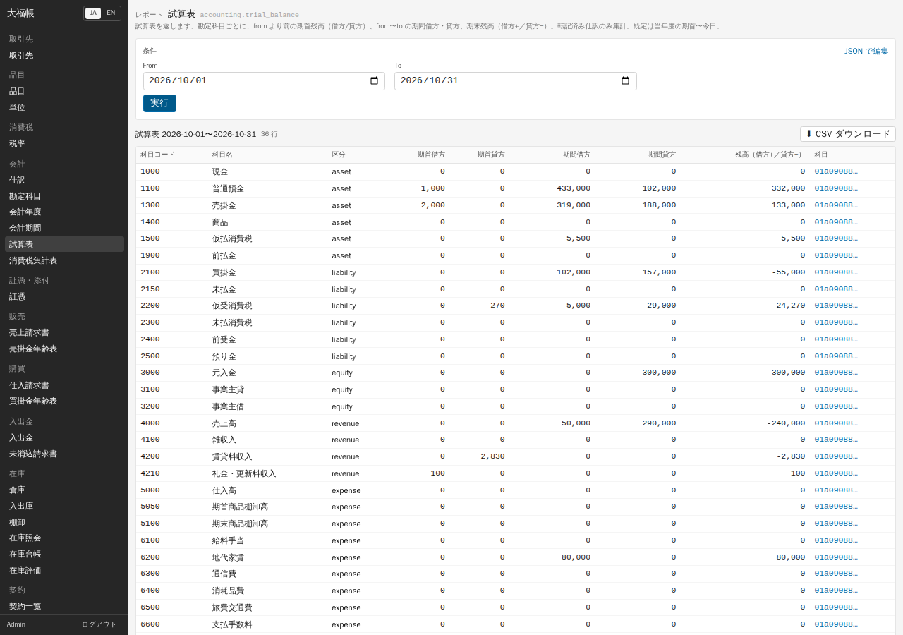
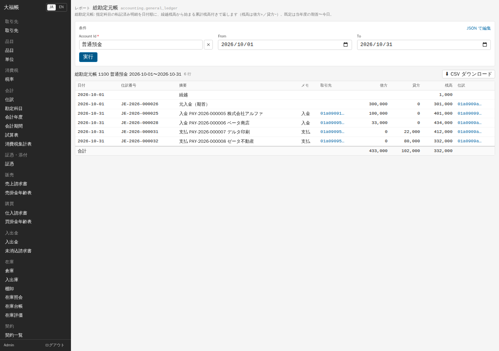
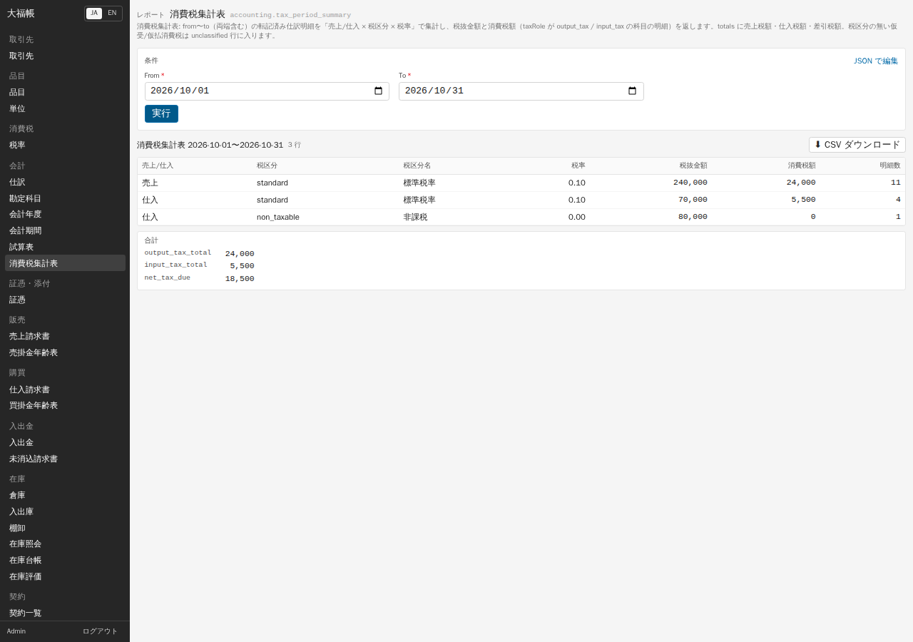
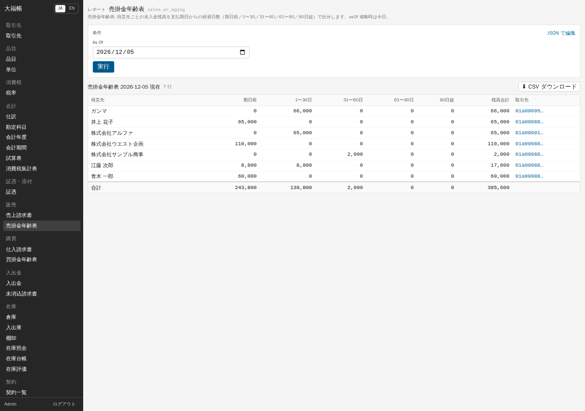
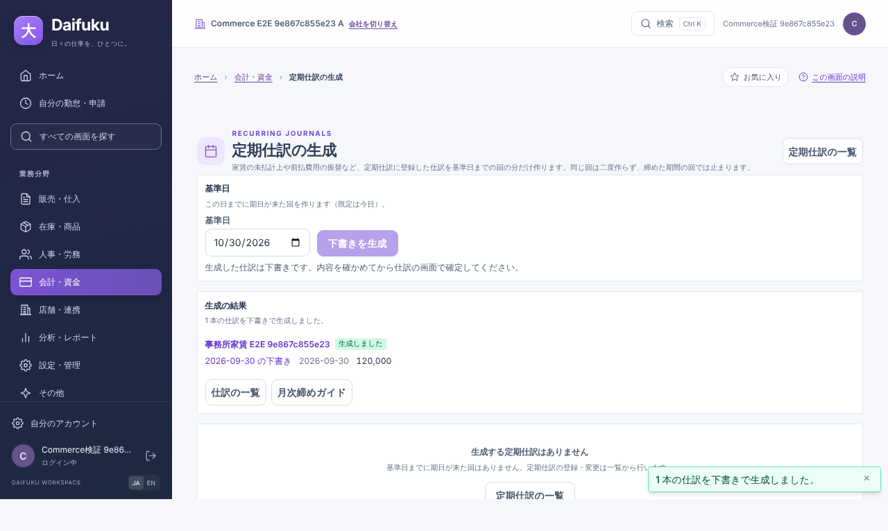
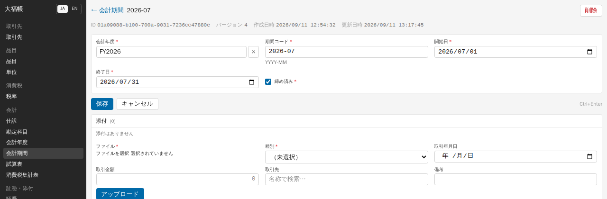
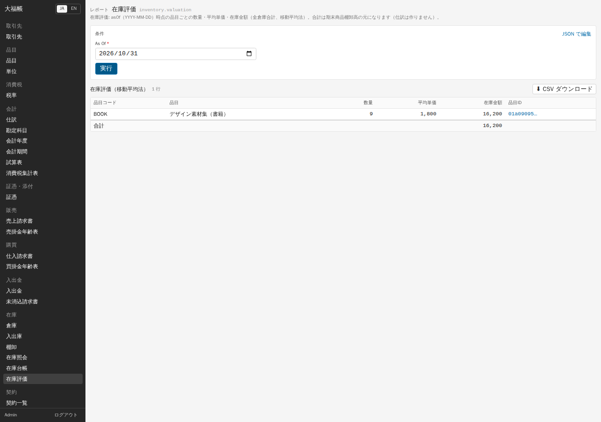

# 06 月次の作業

締め済み年度からのBS/PLと給与の申告準備、原資料の確認・出力は [付録L](appendix-l-commerce-bank-filing.md) にあります。HOT010用の会計資料は当期損益振替前を対象にします。資料出力は行政への提出を行いません。

月末には、帳簿の残高を確かめ、消費税の集計を確認し、未入金・未払を洗い出してから、その月を締めます。この章の表はすべて「レポート」画面で作ります。

## レポート画面の使い方

1. 「分析・レポート」から対象のレポートを選びます。「すべての画面を探す」でも帳票名を検索できます。
2. 「条件」欄で期間や基準日、科目などを確認します。認識できる日付・年月・年には初期値が入り、今月・先月などの簡単入力も使えます。帳票が明示する項目名や初期値は保持されます。詳しくは [付録M](appendix-m-analytics.md) を参照してください。「月次締め」画面のリンクから開いたときは、その会計期間の開始日・終了日（または基準日）が入っています。
3. 「実行」を押すと表が出ます。
4. 「⬇ CSV ダウンロード」で、表示中の表を CSV ファイルに保存できます（Excel で開けます。内部 ID の列も含まれます）。

表の右側に「科目」「取引先」などの内部 ID（`01a09088…` のような文字）の列が出ることがありますが、業務では使いません。

## 試算表

「分析・レポート」から「試算表」を開きます。期間を指定すると、勘定科目ごとに期首残高（借方・貸方）、期間中の借方・貸方、期末の残高が出ます。残高は借方がプラス、貸方がマイナスで表示され、一番下の合計行で残高の合計が 0 になっていれば貸借が一致しています。確定した仕訳だけが集計されます。取引の無い科目も 0 の行として表示されます。

期首残高を取り込んだ会社では（「[03 初期設定](03-setup.md)」の「期首残高の取込」）、最初の会計年度の期首日から実行した試算表の **期首借方・期首貸方** に期首残高が出ます（期首伝票はすべて期首日の前日付のため）。`3900 期首残高仮勘定`（設定 `accounting.opening_balances` の科目）の期首残高が 0 であることを確かめてください。0 でなければ、開始仕訳の売掛金・買掛金の合計行と期首請求書の合計が一致していません（「期首残高の取込」の画面の状況に、仮勘定へ回した科目が出ます）。

## 総勘定元帳

「分析・レポート」から「総勘定元帳」を開きます。科目（例: 普通預金）を選び、期間を確認して実行すると、その科目の仕訳明細が日付順に、繰越残高から始まる累計残高付きで出ます。画面の初期期間は当月です。条件を省略してAPIを呼ぶ場合の年度初期値とは区別してください。

## 消費税集計表

「分析・レポート」から「消費税集計表」を開きます。期間を指定すると、確定した仕訳の明細を「売上 / 仕入」×「税区分」×「税率」で集計し、税抜金額と消費税額を出します。表の下の「合計」欄の意味は次のとおりです。

| 表示 | 意味 |
|---|---|
| output_tax_total | 売上の消費税額（仮受消費税）の合計 |
| input_tax_total | 仕入の控除対象の消費税額（仮払消費税）の合計 |
| net_tax_due | 差引（売上の税額 − 仕入の税額）。納付見込額の目安 |

- 非課税の取引（家賃など）は、税額 0 の行として出ます。
- 免税事業者からの仕入の「控除対象外消費税」は費用に含まれるので、仕入の税額には入りません。
- 集計は仕訳の日付（請求書なら請求日）で行います。
- **これは申告書ではありません。** 簡易課税、2 割特例、課税売上割合、申告書の様式には対応していません。申告は税理士や会計ソフトで行ってください。

## 売掛金年齢表・買掛金年齢表

「分析・レポート」から「売掛金年齢表」または「買掛金年齢表」を開きます。基準日（As Of）を入れると、取引先ごとに未入金（未払）の残高を、支払期日からの経過日数で「期日前」「1〜30 日」「31〜60 日」「61〜90 日」「90 日超」に分けて出します。期日当日は「期日前」に入ります。督促の対象を探すときに使います。

## 月次締めガイド

「会計・資金」から「月次締め」を開きます（「すべての画面を探す」で「月次締め」と検索しても出ます。経理または管理者の役割の利用者だけに表示されます）。締める前に残っている作業を件数で確かめ、一覧で片付けてから、同じ画面で会計期間を締めます。

1. 「会計期間」で締める月を選びます。最初は、終了日が今日より前で、まだ締めていない最も古い期間が選ばれています（無ければ今日を含む期間）。選ばれた期間は URL（`?periodId=`）にも入るので、締めた後や再読み込みの後も同じ期間のままです。会計年度をまだ開いていない会社では「会計年度がまだありません」と表示され、「会計年度を開く」から開けます。
2. 「締めを止める項目」を確認します。仕訳と、確定すると仕訳を作る伝票（売上請求書・仕入請求書・入出金など）の、その期間の日付の下書きの件数です。期間を締めると確定できなくなるため、「一覧を開く」から開いて確定するか削除します。一覧はまだ状態や日付で絞り込めないので、画面に出ている対象期間（「2026-09-01〜2026-09-30の下書き」など）を見て探してください。
3. 「確認事項（締めは止めません）」を確認します。前の会計期間が締まっていない（「未締め」と表示。「その期間を開く」で同じ画面のその期間へ移ります）、仕訳を作らない伝票（入出庫伝票など）の下書き、期間の末日までに確定した入出金で未配分額が残るもの、期間内の銀行明細で照合していないもの（「銀行照合を開く」）、の件数です。必要なら片付けますが、残っていても締められます。件数が 0 の項目は、締めを止める種類のものも含めて、その下の「問題のない項目（n）」に畳んで表示されます。
4. 「締めの前に見るレポート」から試算表・総勘定元帳・消費税集計表・売掛金年齢表・買掛金年齢表・在庫評価を開きます。期間（年齢表と在庫評価は期間の末日）が入った状態で開くので、「実行」を押して残高や税額を確かめます。
5. 他の画面で片付けたら「再点検」を押します。締めを止める項目がすべて 0 になると「この期間を締める」が押せるようになります。0 でない間はボタンが押せず、ボタンの横に残っている項目と件数が出ます。点検の結果はスクリーンリーダー向けにも通知します。点検に失敗したときは「最新の点検に失敗しました」と表示され、前回の結果のまま締めることはできません（「点検をやり直す」で再実行）。
6. 「この期間を締める」を押し、確認画面で「締める」を押します。締める直前にもう一度点検し、その間に下書きが増えていたら（または別の利用者が先に締めていたら）締めずに理由を示します。締めると、同じ期間が「締め済み」と表示されます。

締め済みの期間を選ぶと、締め済みであることと訂正の案内、「この期間を再開」ボタンが出ます。確定済みの伝票を直すときは、期間を再開せずに、伝票の「取消」で開いている期間の訂正日を指定します（[付録 C](appendix-c-ui-refresh.md)）。期間に戻って直す必要があるときだけ再開し、直したら締め直してください。

この画面は点検と案内だけを行い、伝票を自動で確定したり、在庫の締めや決算整理仕訳を作ったりはしません。点検は画面を開いた利用者が読める伝票だけを数えます（読めない種類の伝票は項目に出ません）。同じ点検は `accounting.close_readiness` アクションで呼べます（`periodId` を省略すると上の既定の期間）。

## 定期仕訳を生成する

「[定期仕訳を登録する](05-daily.md#定期仕訳を登録する)」で登録した定期仕訳から、期日が来た回の仕訳を作ります。経理と管理者が使えます（受信箱に「生成待ちの定期仕訳」が出たらこの画面を開きます）。

1. 「会計・資金」から「定期仕訳の生成」を開きます（画面検索でも開けます）。
2. 「基準日」（既定は今日）までに期日が来た回が、定期仕訳ごと・回ごとに一覧で出ます。状態は「生成する」「止まる」（締めた期間・会計期間が無い日付）「定期仕訳の内容に誤り」「止まった回より後」です。「止まる」「定期仕訳の内容に誤り」の行には、どうすればよいかが行の下に出ます（内容の誤りは「技術情報」を開くと検査の要約も見られます）。生成する回が無くてボタンが押せないときも、ここで理由を確かめられます。
3. 「下書きを生成」を押し、確認画面でもう一度「下書きを生成」を押します。
4. 結果に、作った仕訳（下書き）へのリンクと、止まった定期仕訳の回・理由・どうすればよいかが出ます（キーボードの焦点は結果の見出しに移ります）。作った下書きは「仕訳」の一覧と「月次締め」の「締めを止める項目」（仕訳の下書き）にそのまま現れるので、内容を確かめて確定してください。

- **同じ回は二度作りません**。もう一度押しても、作り済みの回は作られません。2 人が同時に押しても、回ごとに 1 本だけです。
- **締めた期間の回で止まります**。その定期仕訳はその回から先を作らず（後の回を飛ばして先へ進みません）、他の定期仕訳は続けます。期間を再開してからもう一度生成するか、要らない回なら定額の定期仕訳の開始日を後ろにずらします（按分の回の日付は変えられません）。会計年度を開いていない日付の回も止まります。
- 作った下書きを削除すると、その回は「飛ばした」扱いになり、もう作られません（「定期仕訳の生成記録」の行は残り、「仕訳」が空になります）。必要なら仕訳を手入力するか、別の回の仕訳を開いて「複製」します。
- 1 回に作る仕訳は 200 本までです。上限に達したと出たら、もう一度押すと続きを作ります。
- 会社設定（「設定」の「会計」）の「定期仕訳を生成と同時に確定」をオンにすると、ボタンが「生成して確定」になり、作ると同時に確定（転記）します。既定はオフ（下書きのまま）です。確定できない回（借方と貸方の不一致など）は下書きも残しません。
- 確定した生成仕訳は手入力の仕訳と同じです。誤りは逆仕訳（`accounting.reverse_entry`）で打ち消します。

定期実行（毎日決まった時刻に自動で作る）はありません。同じ処理は `accounting.generate_recurring`（`asOf`、`templateId`）で、予定の一覧は `accounting.recurring_schedule` で呼べます。

## 期間の締め

締めた期間の日付では、仕訳も、請求書・入出金の確定（自動で作られる仕訳）もできなくなります。ふだんは上の「月次締めガイド」から締めてください。ガイドを使わずに締めることもできます。

1. 「会計・資金」から「会計期間」を開き、締める月（例: `2026-07`）の行を押します。
2. 「締め済み」にチェックを入れて「保存」を押します。
3. 締めを戻すときは、同じ画面でチェックを外して「保存」します。

締めと再開は監査ログに「update」として残ります。管理者は同じことを `accounting.close_period` / `accounting.reopen_period` アクションで行うこともできます（監査ログ上はどちらも同じ「update」です）。この方法では下書きの残りを確かめないので、先に月次締めガイドかアクション `accounting.close_readiness` で点検してください。会計期間の画面には「削除」ボタンも表示されますが、押さないでください。

## 在庫評価

「分析・レポート」から「在庫評価」を開きます。基準日を入れると、その日時点の品目ごとの数量・平均単価・在庫金額（全倉庫の合計、移動平均法）が出ます。合計が期末商品棚卸高の元になります。

**税務上の注意**: 棚卸資産の評価方法を税務署に届け出ていない場合、税務上の評価は「最終仕入原価法」になります（法人税法施行令 31 条、所得税法施行令 102 条。開発資料 `docs/domain/inventory.md` による）。大福帳の在庫評価は移動平均法なので、申告に使うなら移動平均法の届出が要ります。最終仕入原価法の評価額は v0.1 では出せません。

在庫評価の金額から「商品 / 期末商品棚卸高」の決算整理仕訳を作る機能は、小売テンプレートの「月次締め」にあります（「[07 導入テンプレート](07-templates.md)」）。テンプレートを使わない場合は、仕訳画面で手入力します。

## 月末の作業の流れ（例）

1. 「定期仕訳の生成」で当月末までの回を作り、下書きを確かめて確定する（家賃の未払計上・前払費用の振替など）。
2. 当月の請求書・入出金をすべて確定する（「月次締め」の「締めを止める項目」が 0 になるまで）。
3. 固定資産がある場合は「償却の実行」で当月の減価償却を試算・実行する（[付録 O](appendix-o-fixed-assets.md)。受信箱の「償却が未実行の資産」が消えることを確かめる）。
4. 棚卸をして確定する（物品を扱う場合）。
5. 試算表で普通預金・現金の残高を通帳や現金と照合する（「月次締め」のレポートから開くと期間が入っています）。
6. 売掛金年齢表・買掛金年齢表で、期日を過ぎた残高を確認する。
7. 消費税集計表を確認し、CSV を保存する。
8. 「月次締め」で確認事項を見てから、会計期間を締める。

---

検証: 2026-09-11 実機で確認（画面で操作）— 試算表・総勘定元帳（科目選択）・消費税集計表（10 月: 売上 標準 240,000/24,000、仕入 標準 70,000/5,500、非課税 80,000）・売掛金年齢表（期日当日が「期日前」に入ることは API で確認）・買掛金年齢表・在庫評価の実行、試算表の CSV ダウンロード（BOM 付き UTF-8、内部 ID の列を含む）、会計期間の「締め済み」チェックでの締めと解除、締めた期間の日付の仕訳の確定拒否（API）、`accounting.close_period` / `reopen_period`（API。監査ログの action 欄が空で update として残ること）。未検証: 締めた期間の日付の請求書・入出金の確定拒否（仕訳と同じ検査を通るはずだが未確認）、会計期間の削除、期間を省略した総勘定元帳。

検証（定期仕訳の生成）: 2026-10-30 ブラウザ試験（`apps/web/e2e/recurring-journals.spec.ts`、Chromium、合成会社）で、画面検索から開く、予定に「生成する」の回が出る、390px 幅で予定と確認画面が横にはみ出さない、確認画面で生成、結果の見出しへの焦点、結果のリンクから下書きの仕訳を開く、読み直して「生成する定期仕訳はありません」、月次締めガイドへのリンク、英語表示、axe（日本語 1280px・390px、英語 390px）、閲覧者には画面検索に出ず URL を直接開くと権限が無い説明が出ることを確認。同じ回を二度作らない（2 つの同時実行を含む）、締めた期間・締めた年度・会計期間なしで止まる、内容の誤り、按分の端数、自動確定のオン・オフと月次締めガイドの下書き件数、別会社、生成記録、上限 200 本の続きは DB 試験（`modules/accounting/test/recurring.db.test.ts`）、受信箱の項目の件数は DB 試験（`modules/accounting/test/todo.db.test.ts`）で確認。未検証（ブラウザ）: 自動確定オンの画面（「生成して確定」の文言は web 単体試験のみ）、「止まる」「定期仕訳の内容に誤り」の行と結果の表示（文言は web 単体試験のみ）、受信箱に「生成待ちの定期仕訳」が出ること、上限に達したときの表示。

検証（月次締めガイド）: 2026-10-29 ブラウザ試験（`apps/web/e2e/close-guide.spec.ts`、Chromium、合成会社）で、画面検索から開く、既定の期間、期間の選択、仕訳の下書き 1 件が残る間の締めボタン無効と理由の表示、試算表リンクの期間と初期値、下書き確定後の締め、締める直前の再点検（後から作った下書きで締めない）、締め済み表示と再開、390px 幅、英語表示を確認。件数の規則（期間外・別会社の下書きを数えない、未配分の入出金・未照合の銀行明細、読めない伝票を出さない）は DB 試験（`apps/api/test/close-readiness.db.test.ts`）で確認。2026-10-30 レビュー指摘の修正後、同じ試験に、既定の期間のまま締めても同じ期間に留まること、矢印キーでの期間選択、締めを止められたときの焦点、点検失敗の表示、前の期間へのリンク、権限の無い利用者への説明、会計年度の無い会社の表示（応答を差し替えた試験）を追加して確認。画面の撮影画像はこの章に追加していない。
